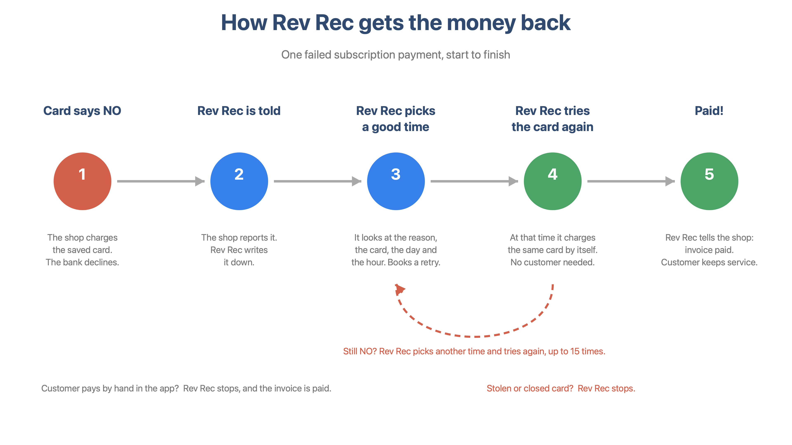

# Rev Rec, explained simply

## What is Rev Rec?

A shop charges your saved card every month. Sometimes the bank says **no**.
Rev Rec is a helper that tries the card again, at a smart time, until the money comes in.

## The five steps

1. **Card says NO.** The shop charges the saved card. The bank declines.
2. **Rev Rec is told.** The shop reports the failure. Rev Rec writes it down.
3. **Rev Rec picks a good time.** It looks at the reason, the card, the day and the hour. It books a retry.
4. **Rev Rec tries the card again.** At that time it charges the same card by itself. No customer needed.
5. **Paid!** Rev Rec tells the shop the invoice is paid. The customer keeps the service.

Still no? Rev Rec picks another time and tries again, up to 15 times.
Stolen or closed card? Rev Rec stops.
Customer pays by hand in the app? Rev Rec stops, and the invoice is paid.

## What the simulator is

A copy of the Hyperswitch dashboard with a **play button** on it.

- **You** play the shop: give the customer's card (4242 is fine), then press **Charge customer**.
- **Rev Rec** is real. It runs on our own copy of Hyperswitch.
- **The bank** is Stripe's test mode, with a script. The story decides when the bank says no and when it says yes again.
- **Pause** stops the story. Rev Rec waits until you press **Resume**.
- **The screen** shows each step as it happens. Press **Next** to see the next one. Click **Why** to see the reason.

## The four screens

| Screen | What you do |
|---|---|
| **Invoice story** | Watch one payment go from NO to PAID, step by step. |
| **Portfolio run** | Send 10 payments at once. See how many Rev Rec gets back. |
| **Feature tour** | One card per Rev Rec feature, with the real settings. |
| **Glossary** | Any underlined word, explained. |

## Honest notes

- **"Rule-based"** on a step means our simple explanation, not Rev Rec's real brain. We are waiting for access to it.
- **"Bank: scripted"** means we decide when the pretend bank has money again. Rev Rec's choices are real.
- **Smart mode uses made-up numbers.** Rev Rec's real model picks the times, but the success counts it reads are invented for the demo.
- **"Computed"** next to "the fixed timetable would have needed N tries" means we worked it out. That timetable did not run.

## Try it

Open http://localhost:9000/dashboard/v2/recovery/home and press **Try It Out**.
