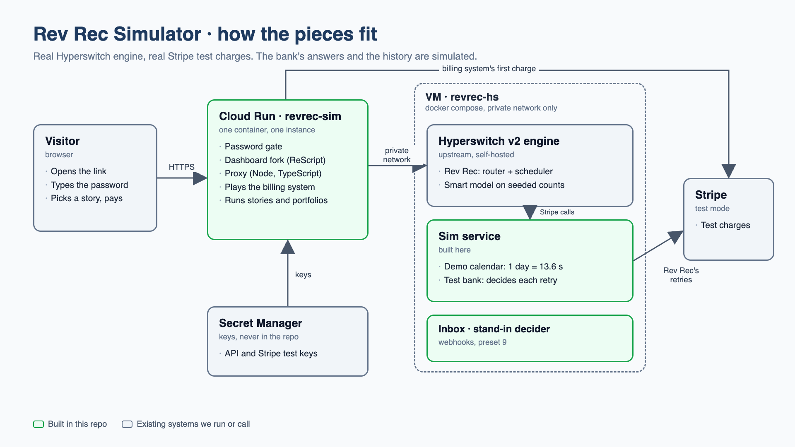

# Rev Rec Simulator · what we built and how it works

_A learning guide for Aayush. Written 24 Oct 2026 from the code, the builders' notes and the live sandbox runs. Plain words. Every claim here was observed, not planned._

## 1. In one paragraph

We forked the open-source Hyperswitch dashboard, kept its Revenue Recovery (Rev Rec) module, and added a simulator inside it. The simulator does not fake Rev Rec. A small server we wrote, the **proxy**, plays the merchant's billing system: it makes real Stripe test charges, reports the failures to the real Hyperswitch sandbox, and Rev Rec on the sandbox books and performs real retries. The dashboard shows every step as it happens, and a click on any step shows the raw request, the response, and a plain-words "why". Everything runs on your laptop today: dashboard on port 9000, proxy on port 8787. The code is on GitHub at `0xyush/hyperswitch-control-center`.



## 2. The six parts

| Part | What it is | Built by us? |
|---|---|---|
| Dashboard fork | The Hyperswitch control center (ReScript + React). We kept the Rev Rec module and added six screens under `src/RevenueRecovery/Simulator/`. A demo session skips the login. | Yes (screens) |
| Proxy | A Node 24 TypeScript server on port 8787 (`simulator/proxy/`). The browser talks only to it. It holds the API key and the dashboard token, passes an allow-list of reads to the sandbox, answers the dashboard's user and merchant lookups with fixed stubs, and plays the billing system. | Yes |
| Hyperswitch sandbox | `sandbox.hyperswitch.io`. Runs the real Rev Rec engine. We report charges to `POST /v2/recovery` and read status from the same endpoints the real dashboard uses. | No |
| Rev Rec engine | Inside the sandbox. Takes an invoice from Monitoring to Queued, Scheduled, Processing and then Recovered or Terminated. Retries the saved card by itself (a merchant-initiated charge, no customer present). | No |
| Stripe test mode | Where the real charges happen. Two saved cards do the work: 4242 always approves, 0341 always declines. Five one-off cards give real decline reasons for the first charge: 0002 generic decline, 9995 insufficient funds, 0119 processing error, 9979 stolen card, 0069 expired card. | No |
| Demo merchant | Your Rev Rec sandbox merchant with three profiles: the original story profile, and two new ones for the portfolio run, `sim-static` (cascading retries) and `sim-smart` (smart retries). Each profile has a Custom billing connector and a Stripe test connector. | Set up by us |

## 3. The screens, in the order a visitor sees them

**Home** (`/dashboard/v2/recovery/home`). Two cards, placed and styled like Orchestrator's "Make a test payment" and "Explore Smart Retries": **Try It Out** opens the Invoice story, **Explore Revenue Recovery** opens a guided side drawer with five steps that link into every screen.

**Invoice story** (`/simulator/story`). The core screen.
- Left: the **billing system form**. Preset dropdown (fills the fields), amount, currency, saved card, customer, and one button, **Charge customer**. Once an invoice exists: **Customer pays in app**, and a menu with Report another failure, Cancel invoice, Start over.
- Right, top: **What happened**, a sequence diagram with four lifelines (Billing system, Rev Rec, Processor, Customer). Each real event appends one arrow with a label and a time. Red for declines, green for approvals, dashed with a countdown for a retry Rev Rec has booked but not yet run. Nothing animates.
- Right, below: the **real invoice detail page** from the Rev Rec module (status alert, order details, attempts history), updating live.
- Click any arrow or attempt: a **side drawer** with what happened, who did it to whom, the time, the "why" lines each tagged with a source, and the raw request and response with secrets hidden. An **Invoice states** button shows when each state was first seen.

**Portfolio run** (`/simulator/portfolio`). Many invoices at once, each run twice: once on `sim-static`, once on `sim-smart`, each copy with its own Stripe customer. Dials on the left (10 or 25 invoices, amount, decline-mix sliders, stop-after). Results on the right: four cards (recovery rate, recovered amount, attempts per recovery, minutes to recovery) with Static retries and Rev Rec side by side, recovery by decline reason with the bank rules under it, recovery over time, and the invoice table where each status opens that copy's story. Every number carries a source chip.

**Feature tour** (`/simulator/tour`). One panel per Rev Rec feature, 16 in all, each tagged **Live**, **Read-only** or **Display only**. Live and read-only panels show the real values read from your profile (retry mode, start rule, max retries, grace period). Display-only panels explain features we do not run (record back, multi-card, account updater, partial auth, dunning, integration models, processor choice).

**Glossary**. Underlined terms anywhere open a drawer with the plain-words definition (soft and hard decline, monitoring, static and smart retries, start rule, grace period, MIT, processor token, record back, webhook, error catalogue).

**Health page** (`/simulator/health`, URL only). For operators: sandbox and Stripe reachability, token expiry, the merchant switch, rate limits, blocked calls, active stories and runs, and the hourly API contract test.

## 4. One story, step by step

What really happens when you pick the preset "Temporary error, retry works" and press **Charge customer**:

1. The proxy creates a Stripe test customer and saves card 4242 on it.
2. The proxy makes one real charge on card 0002. Stripe declines it (generic decline). This is the billing system's own monthly charge failing.
3. The proxy reports that failure to the sandbox with `POST /v2/recovery` (transaction status: failure, the saved card's token). The sandbox checks the charge with Stripe and records Stripe's real decline.
4. With the start rule at 0, Rev Rec takes over at once. Status: Monitoring, then Queued.
5. Rev Rec picks a retry time. On the cascading profile the sandbox books it about 30 seconds out. Status: Scheduled. The diagram shows a dashed row with a countdown.
6. At that time Rev Rec charges the saved card 4242 by itself. Status: Processing. Stripe approves.
7. The invoice is Recovered. The diagram adds "invoice recovered → mark paid". Total: about one minute.

The proxy learns all of this by polling the sandbox every few seconds: the invoice, its attempts, and the process tracker (which holds the booked retry time). Each poll result becomes rows in the diagram.

## 5. Why the "why" has three source labels

Every explanation line carries one of three tags, so nobody mistakes a guess for a fact:

- **From the sandbox**: read from the real system (the booked time, the attempt result, Stripe's decline).
- **Re-computed**: worked out from sandbox data (which ladder step this is, how many retries remain against the network cap).
- **Rule-based**: the simulator's stand-in explanation for smart timing (for example "insufficient funds: month start, Thursday or Friday", from the Appercut report patterns). This is **not** the real Rev Rec model. The model needs access we have asked Kirthi for.

## 6. The portfolio run and the scripted bank

A Stripe test card answers the same at every hour, so on its own the sandbox cannot show that smart timing recovers more than static timing. The proxy therefore also plays the **customer's bank**, by a rule shown on screen: for example "insufficient funds: the card works again 4 to 12 minutes after the first failure". When the rule says the money is back, the billing simulator makes a real charge on the good card and reports it, so the next Rev Rec retry succeeds. Hard declines (stolen, expired) never flip. The screen labels these rules "Bank: scripted". Rev Rec's decisions stay real.

We proved the mechanism on 23 Oct: after a decline, a new report carrying the good card made Rev Rec's next retry use that card and recover the invoice in 3.6 minutes.

## 7. What the runs showed

**Run 1, 23 Oct (`pf_5f2dcd18`), both sides on one static profile.** 10 invoices. 7 of 10 recovered on each side with 39 Rev Rec attempts each. Generic decline 3 of 3, processing error 2 of 2, insufficient funds 2 of 4, stolen card 0 of 1. The two insufficient-funds misses were the proxy's fault: a heavy local build stalled its loop, the bank flips came 14 to 16 minutes late, and Rev Rec had already used its retries. The stolen card was retried 7 times before terminating: the sandbox has no hard-decline stop for Stripe's code yet.

**Run 2, 24 Oct (`pf_4744661b`), first run on the two real profiles (start rule 0, max retries 15).** Final: the static side recovered 8 of 10 with 55 attempts; the smart side booked **zero retries** on all 10 invoices and they were cancelled at the end. This is the risk the PRD named: smart mode needs a decider service behind it, and the sandbox has none for this merchant. Until Kirthi provides one (ask 2), the portfolio screen shows the smart side as 'no retries booked' and makes no uplift claim.

## 8. Facts about the sandbox we learned the hard way

- `POST /v2/recovery` no longer takes an `action` field. The sandbox checks every reported charge with Stripe and records Stripe's real decline, not the reason we report. A decline reason therefore needs the matching Stripe test card.
- Duplicate reports are now refused with 400 (on 14 Oct they were silently accepted).
- The cancel endpoint works now (`POST /v2/recovery/{invoice}/cancel` returns 200).
- Adding a billing connector resets a profile to monitoring, so the retry mode must be set last.
- Rev Rec stops an invoice after about 7 of its own retries at the sandbox pace (about 16 minutes).
- The sandbox's CDN blocks the hyphenated path `list-attempts`; the underscore `list_attempts` works.
- A start rule of 1 means "after more than one failure". We set the demo to 0.
- Hard declines are not stopped: a real stolen-card decline was retried.

## 9. Security choices

- The browser never holds a real token. It sends a placeholder; the proxy swaps in the real dashboard token, which it has first exchanged for one scoped to the Rev Rec merchant only.
- The proxy allows only a list of Rev Rec reads. Connector, API key and user endpoints return 403.
- User, org and merchant lists are fixed stubs, so a public demo never shows real users.
- Secrets live in a git-ignored `.env`. Everything that leaves the proxy passes through a redactor. One leak was caught and fixed (a webhook signing key in a profile read).
- Rate limits per browser session and per IP. One portfolio run at a time.
- An hourly contract test sends the real request shapes to the sandbox and checks every field we read, so a silent API change shows on the health page instead of breaking a demo.

## 10. How to run it

Two terminals in `~/work/revrec-simulator`:

```
# terminal 1, the proxy
cd simulator/proxy && npm install && SIM_PORTFOLIO=1 RATE_LIMIT_STARTS_PER_HOUR=30 npm start
# terminal 2, the dashboard
npm install && npm run re:build && npm run start
```

Then open http://localhost:9000/dashboard/v2/recovery/home. Health check: `curl -s localhost:8787/healthz`. The dashboard token expires on 25 Oct at 09:07 PDT; refresh it with `bash simulator/scripts/grab-jwt.sh` while logged in to the sandbox dashboard in Chrome.

Tests: `cd simulator/proxy && npm test` (28 offline tests plus one live story, about a minute).

## 11. Files worth knowing

| Where | What |
|---|---|
| `simulator/proxy/src/story.ts` | The billing simulator, story view and explain lines |
| `simulator/proxy/src/portfolio.ts` | The portfolio run and the scripted bank |
| `simulator/proxy/src/passthrough.ts`, `shell.ts` | The allow-list and the shell stubs |
| `simulator/proxy/src/auth.ts` | The token switch to the Rev Rec merchant |
| `simulator/proxy/src/contract.ts` | The hourly API contract test |
| `simulator/proxy/scripts/` | Operator scripts: profile setup, start rule, retry mode, token grab |
| `src/RevenueRecovery/Simulator/` | The six screens (Story, Portfolio, Tour, Glossary, Health, Home) |
| `simulator/STATUS.md` | Honest status: what works, what is stubbed, what waits on whom |
| `simulator/DEMO.md` | The 10-minute demo script |
| `simulator/PORTFOLIO.md`, `REDESIGN-story.md`, `BUILD.md`, `NOTES.md` | Design, brief, plan and the builders' running log |
| `simulator/deploy/` | Dockerfiles and the Cloud Run plan (not deployed) |

## 12. What is still open

**With Kirthi (PRD section 14):** the real model and decider (for a real "why this slot" and for smart mode to book retries at all), outgoing webhooks, whether max retries and grace period are enforced, the ladder values, approved pilot numbers, a hard-decline error-catalogue row for Stripe's stolen-card code, a low-rights demo dashboard user, decision-log access, and the card network limit values.

**With you:** deploy to GCP when you want a shareable link (commands are ready), share the PRD and one-pager with reviewers, send Kirthi the asks, and refresh the dashboard token before it expires.
