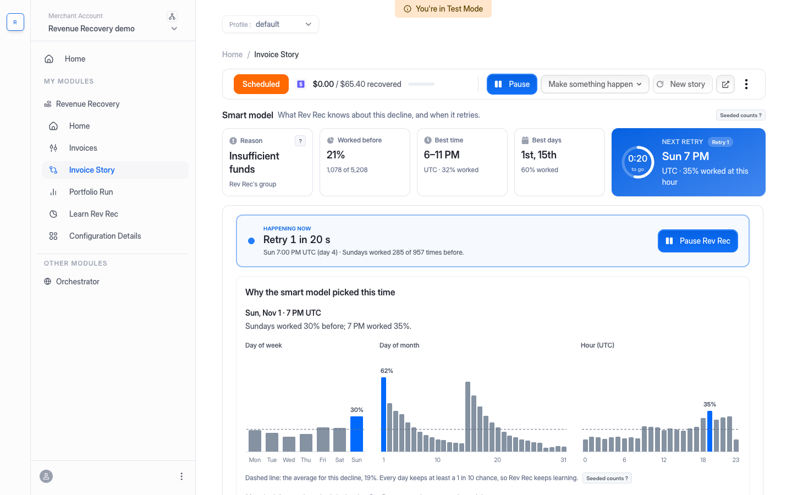
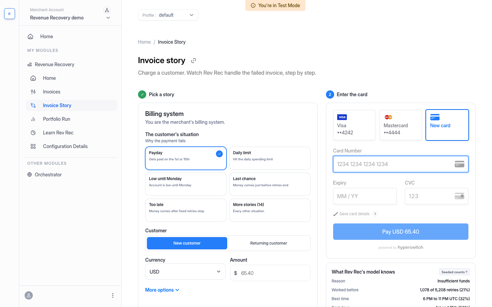
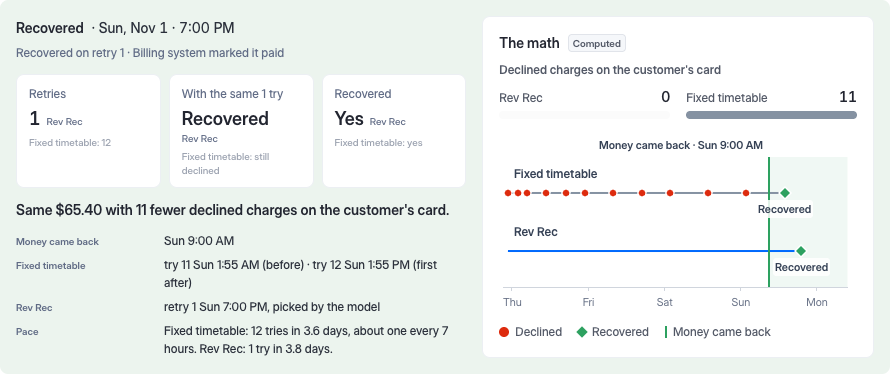

# Rev Rec Simulator

Try Hyperswitch **Revenue Recovery (Rev Rec)** hands-on. You charge a customer, the payment fails, and you watch Rev Rec's smart model retry it. Everything runs on a real Hyperswitch v2 engine, with real Stripe test charges.

## What you can do

| Screen | What it shows |
| --- | --- |
| **Invoice story** | Pick a customer situation and pay with a test card. The payment fails, and you pass the invoice to Rev Rec. Then you watch each retry, step by step. |
| **Smart model** | The decline group and how often retries worked before. Also the best hour and days, the next retry with a countdown, and charts that show why the model picked that time. |
| **Result** | Rev Rec's retries against today's fixed timetable, "with the same N tries", and declined charges the customer avoided. A timeline shows both sides. |
| **Portfolio run** | The same invoices with two strategies, smart and fixed. It shows recovery rate, attempts per recovered invoice and time to recover. |
| **Learn Rev Rec** | Short lessons with flow diagrams and a check at the end of each. |

**Stories:** Payday, Daily limit, Low until Monday, Last chance and Too late, plus 14 more.

**While a story runs:**
- Pause or resume Rev Rec.
- Make something happen: the money comes back, the customer pays in the app, the card fails again, the card is stolen, the bank has an outage, or the customer cancels.

| Pick a story, then enter the card | The result |
| --- | --- |
|  |  |

## What is real and what is simulated

| Real | Simulated |
| --- | --- |
| Hyperswitch v2 engine (upstream), self-hosted | The bank's answer to each retry (a test bank in the sim service) |
| Rev Rec's scheduler and its own smart model | The model's history (seeded counts, `selfhost/MODEL.md`) |
| Stripe test-mode charges and declines | Time: one real day takes 13.6 s on the demo calendar |
| `/v2/recovery` reports, invoice states, webhooks | |

**Honest limits:**
- The engine's model groups declines by decline code only. Card network, card type and issuer are not used, so Visa and Mastercard get the same numbers.
- Smart retries never retry on the day of the failure, so on time alone the fixed timetable can be faster. The simulator compares retries and declined charges, like for like.
- This demo uses Stripe only. The other processors are behind a flag.
- Rev Rec charges only the card the customer gave for the invoice. A switch to another card is hidden.

## How it works

- **Cloud Run (`revrec-sim`)** is one container. It holds the password gate, the dashboard build and the proxy.
- **The proxy** plays the merchant's billing system. It makes the first charge, reports the failure to Rev Rec and runs the stories.
- **The VM** runs the engine with docker compose on a private network. The engine's Stripe calls go through the sim service's test bank. The bank decides each retry from the story's rule.

## Repo layout

| Path | What is in it |
| --- | --- |
| `src/RevenueRecovery/Simulator/` | The simulator screens (ReScript, in this control-center fork) |
| `simulator/proxy/` | The proxy and billing system (Node 24, TypeScript) |
| `simulator/selfhost/` | The engine: compose file, config, seed, model counts, sim service, inbox, stand-in decider |
| `simulator/deploy/` | Cloud Run: Dockerfile, Cloud Build, password gate, secrets script |
| `simulator/scripts/` | Browser checks (Playwright) |

## Run it locally

You need Node 24, a running engine (`selfhost/README.md`) and a Stripe test key.

1. Start the engine on a VM, then open the tunnel to ports 8080, 8092, 8093 and 8094 (`selfhost/README.md`, "Connect the proxy").
2. Copy `simulator/proxy/.env.vm.example` to `simulator/proxy/.env`. Fill in the values. Never commit this file.
3. Start the proxy: `cd simulator/proxy && npm install && npm start`. It listens on port 8787.
4. Check the proxy: `curl -s localhost:8787/healthz` must answer `"ok": true`.
5. In a second terminal, from the repo root: `npm install`, then `npm run re:build`, then `npm run start`.
6. Open http://localhost:9000/dashboard/v2/recovery/home.

## Deploy

`simulator/deploy/README.md` (sections 5 and 5b) has the full commands. In short:

1. Store the keys in Secret Manager with `simulator/deploy/put-secrets.sh`.
2. Build the image with Cloud Build (`simulator/deploy/cloudbuild.all.yaml`).
3. Deploy one Cloud Run service with Direct VPC egress to the VM's private network.

A redeploy clears the stories that are running, because they live in memory.

## Docs

| Doc | Read it for |
| --- | --- |
| `GUIDE-SIMPLE.md` | Rev Rec explained simply |
| `selfhost/MODEL.md` | The smart model, the seeded counts and the test bank |
| `selfhost/README.md` | How to run the engine |
| `proxy/README.md` | Proxy endpoints and how a story runs |
| `deploy/README.md` | Cloud Run |
| `DECISIONS.md` | Why things are the way they are |
| `NOTES.md`, `STATUS.md` | Build logs (working notes) |

## License

Apache License 2.0, the same as the upstream control center (`LICENSE` at the repo root). The checkout look is adapted from [hyperswitch-web](https://github.com/juspay/hyperswitch-web) (Apache 2.0). Its notice is kept in `src/RevenueRecovery/Simulator/SimulatorCheckout.res`.
